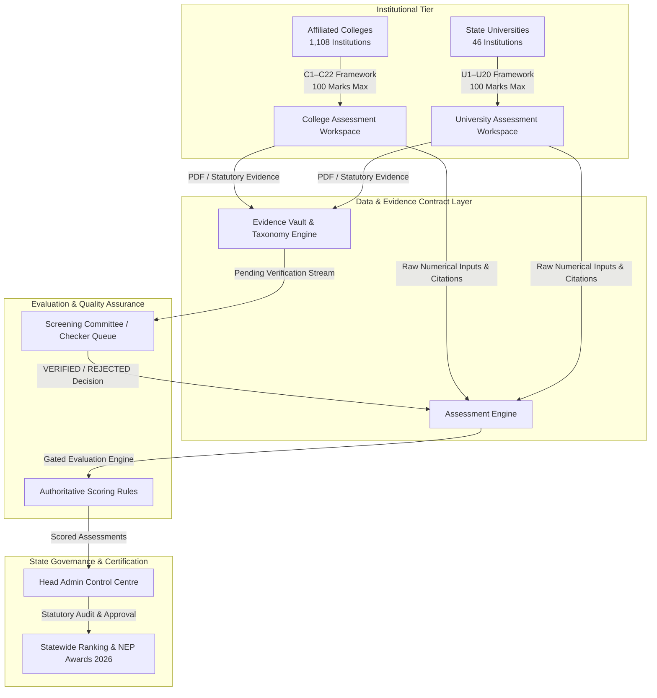
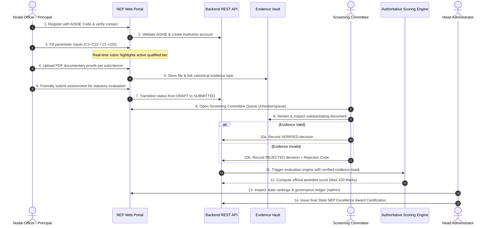

# Haryana NEP Excellence Awards 2026 — Complete Project Walkthrough (A to Z)
### Official Digital Assessment, Evaluation, and Certification Platform

---

## 🎥 Full Platform Video Walkthrough

The browser session recording below captures the live platform in action across all modules, demonstrating the end-to-end journey from the public portal and unified applicant onboarding, through the newly updated institutional rubric workspace, to the screening committee console and head administrative centre:

> 🎬 **Broadcast-Quality Full Video**: [Watch / Download nep_2026_entire_workflow.mp4](file:///c:/Users/Devansh%20Datta/Desktop/PROECTS/haryana/videos/nep_2026_entire_workflow.mp4) (1080p, 69s, 34.8 MB)  
> 🌐 **Interactive Player & Chapters**: [Open videos/video_player.html](file:///c:/Users/Devansh%20Datta/Desktop/PROECTS/haryana/videos/video_player.html)

*Recording captures: Public Landing Page → Leadership & Framework Overview → Unified Applicant Registration (College & University switching) → Principal Authentication → College Assessment Workspace (Parameter C1 with corrected rubric tiers, C4 composite structure, C10 count criteria, C12 checklist badges, C16 policy notice) → Head Admin Control Centre (Statewide metrics, 1,154 institutions, user governance) → Screening Committee Review Console (Dual-pane evaluation, evidence inspection).*

---

## 📸 Screening Committee Verification Console

Below is a live capture from the **Phase W4 Modern Screening Review Console** (`/checker/assessment/...`), showing the independent subcriterion evidence verification, documentary proof viewer, and expected score aggregation:

---

## 🏛️ Chapter 1: Platform Vision & Architecture

The **NEP Excellence Awards 2026** platform is an enterprise-grade statutory evaluation and governance system commissioned by the **Haryana State Higher Education Council (HSHEC)** and the **Department of Higher Education (DHE), Government of Haryana**. 

The system automates the statutory institutional performance audit prescribed under the **National Education Policy (NEP) 2020**, evaluating every higher education institution in Haryana across **100 marks**.

### Core Architectural Invariants
1. **Strict Framework Isolation**:
   - **Colleges (C1–C22)**: Exactly 22 parameters totaling 100 marks.
   - **Universities (U1–U20)**: Exactly 20 parameters totaling 100 marks.
   - Cross-framework contamination is blocked at the database, routing, and UI levels.
2. **Deterministic Canonical Evidence Contracts**:
   - Every claim must map to an authoritative evidence requirement (e.g., `EVID_C1_APPROVED_IDP` for C1.1, `EVID_C2_HOI_CERT` for C2.1).
3. **Evidence-Gated Authoritative Scoring**:
   - Unverified evidence results in a raw claim being held at 0 marks until validated by the Screening Committee.
4. **Zero-Inference Statutory Compliance**:
   - Boundary voids and ambiguities in council PDFs are rendered transparently as official advisory notices rather than inventing unapproved scoring rules.

---

## 🌐 Chapter 2: Public Portal & Accessibility

- **Route**: [`/`](file:///c:/Users/Devansh%20Datta/Desktop/PROECTS/haryana/NEP_HARYANA/Frontend/NEP_HARYANA_INT/src/pages/Home/Home.jsx)
- **Visual Presentation**:
  - State insignia, Governor of Haryana, and Chief Minister leadership portraits.
  - Live statistics: 1,154 higher education institutions, 22 College parameters, 20 University parameters.
  - Dual-language accessibility (English & Hindi) and high-contrast toggle for universal accessibility.
  - Official council notifications, statutory deadlines (Assessment Window: July 1, 2025 – June 30, 2026), and guidelines.

---

## 📝 Chapter 3: Unified Applicant Onboarding & Verification

- **Route**: [`/auth/signup`](file:///c:/Users/Devansh%20Datta/Desktop/PROECTS/haryana/NEP_HARYANA/Frontend/NEP_HARYANA_INT/src/pages/Signup/Signup.jsx)
- **Features**:
  - **Dynamic Institution Switcher**: Instantly pivots between **Affiliated College** and **State University** forms.
  - **AISHE Verification Engine**: Queries statutory AISHE directories in real time. Entering a valid AISHE code autofills institution name, district, affiliation, and college category.
  - **Nodal Officer Verification**: Two-step mobile number and email verification with statutory authority authorization.

---

## 📊 Chapter 4: The Institutional Assessment Workspaces

- **College Workspace**: `/institution/:name/:aisheCode/assessment/:assessmentId`
- **University Workspace**: `/university/assessment/:assessmentId`

### The Phase B UI Corrections in Action
The assessment workspace features the updated **Haryana Higher Education Council Rubric UI**:

| Old Generic UI Defect | Phase B Corrected UI | Statutory PDF Provenance |
|:---|:---|:---|
| **Amber Calculation Assistance Box**: Displayed distracting `numerator ÷ denominator = XX%` calculation box. | **Completely Removed**: Clean, focused interface with subtle, elegant percentage indicators only where relevant. | Clean presentation matching council standards. |
| **Generic Percentage Dropdowns**: Static select box `[0%, 10%, ..., 100%]` forced artificial rounding. | **Direct Numerical Inputs**: Exact institutional counts (`fixed_targets`, `achieved_targets`, `admitted_students`) accepted with full precision. | PDF requires exact counting of targets and enrollment. |
| **Hidden Rubric Marks**: Applicants could not see what marks each threshold awarded. | **Official Rubric Option Cards**: Interactive cards displaying exact thresholds (e.g. `>90% [6 Marks]`, `>75% to 90% [4 Marks]`, etc.). | Verbatim options from Council PDF. |
| **Percentage Metrics on Count Criteria**: Erroneous percentage dropdowns on activity or collaboration counts. | **Dedicated Count Tier Cards**: Integer-based tier cards (e.g., C10.1 active MoUs: `>=5 [5 Marks]`, `4 [4 Marks]`, `3 [3 Marks]`, etc.). | Verbatim count criteria from PDF. |
| **Composite Parameters Blobs**: Multi-part parameters lumped into single blocks. | **Structured Sub-Rubrics**: Explicit **Part 1**, **Part 2**, and **Part 3** sections with separate max marks and rubrics (C4, C9, C11, U4, U5, U8, U9, U14, U16, U19, U20). | Clear separation of distinct subcriteria. |
| **Plain Checkboxes**: Checkboxes lacked visual reward and marks indicators. | **Enhanced Cumulative Checklists**: Checkbox cards featuring exact marks badges (`+1.0 Mark`, `+2.0 Marks`) that dynamically highlight when claimed. | Discrete mark allocation per initiative. |

### Real-Time Tier Qualification Engine
When an institution enters its figures (e.g., 38 achieved targets out of 40 fixed = 95.0% in Parameter C1), the `getActiveRubricOptionId` engine automatically qualifies and highlights the matching card with:
- **Primary Maroon Border & Tint**: `border-[#600b0b] bg-[#600b0b]/5 ring-1 ring-[#600b0b]/30`
- **Active Qualified Tier Badge**: `✓ Active Qualified Tier (+6 pts)`
- **Header Achieved Badge**: `Achieved: 95%`

---

## ⚖️ Chapter 5: Authoritative Scoring Engine & Discrepancy Governance

The backend scoring engine operates strictly on frozen deterministic rules:

1. **Formula-Based Evaluators**:
   - `C1.1`: Achieved / Fixed targets $\times 100 \rightarrow$ mapped to 6, 4, 2, or 1 mark.
   - `C2.1`: Apprenticeship completion ratio $\rightarrow$ mapped to 4, 3, 2, 1, or 0 marks.
   - `C6.1`: VAC/AEC/SEC certified students $\rightarrow$ 6 distinct percentage tiers.
   - `C10.1`: Integer active MoUs $\rightarrow$ 6 distinct count tiers.
2. **Evidence Gating**:
   - If documentary evidence is rejected by the Screening Committee, the score for that subcriterion drops to `0.0`, protecting the integrity of state awards.
3. **Statutory Policy Notices (Zero Inference Rule)**:
   - **C5.1 Boundary Void**: Exactly 75.0% enrollment is uncalculated and blocks certification per council notice.
   - **U5.A Boundary Void**: Exactly 50.0% placement eligibility is uncalculated per council notice.
   - **U10.3 Currency Void**: Exactly Rs. 1,00,00,000 funding is held uncalculated per council notice.
   - **C21.1 Activity Void**: Exactly 1 activity is held uncalculated per council notice.
   - **C16 & U20 Capping**: Checklist items sum to 5.0 marks but the overall parameter total is capped at the statutory maximum of `4.0 marks`.
   - **Scopus Metric**: Held with policy advisory until circular definition.

---

## 🔍 Chapter 6: Modern Screening Committee Review Console

- **Queue Route**: [`/checker/queue`](file:///c:/Users/Devansh%20Datta/Desktop/PROECTS/haryana/NEP_HARYANA/Frontend/NEP_HARYANA_INT/src/pages/Checker/CheckerQueue.jsx)
- **Assessment Review**: `/checker/assessment/:assessmentId`

### Key Capabilities
- **48-Hour SLA Urgency Protocol**: Highlights submissions approaching statutory verification windows.
- **Dual-Pane Document Viewer**: Left pane displays the parameter inputs and calculated score; right pane renders the original PDF documentary evidence with page zoom and rotate.
- **Independent Association Decisions**: Reviewers evaluate individual documents per subcriterion (`VERIFIED` or `REJECTED`).
- **Standardized Rejection Codes**: Mandatory selection from official codes (`INCOMPLETE_DOCUMENTATION`, `OUT_OF_PERIOD`, `UNAUTHORIZED_SIGNATORY`, `ILLEGIBLE_DOCUMENT`, `MISMATCHED_CRITERIA`, `INTEGRITY_MISMATCH`).
- **Append-Only Verification History**: Every action logs reviewer ID, timestamp, decision, and remarks for complete accountability.

---

## 🛡️ Chapter 7: Head Administrator Control Centre

- **Route**: [`/admin`](file:///c:/Users/Devansh%20Datta/Desktop/PROECTS/haryana/NEP_HARYANA/Frontend/NEP_HARYANA_INT/src/pages/Admin/AdminOverview.jsx)

### Governance Modules
1. **Statewide Overview Ledger**:
   - Aggregated metrics across **1,154 total institutions** (1,108 Colleges, 46 Universities).
   - Real-time submission funnel: `DRAFT` $\rightarrow$ `SUBMITTED` $\rightarrow$ `UNDER_REVIEW` $\rightarrow$ `CERTIFIED`.
2. **State Institutions Ledger** (`/admin/institutions`):
   - Searchable, filterable directory with live scores, AISHE codes, and verification stages.
3. **Role & User Governance** (`/admin/users`):
   - Tiered administrative management: `head_admin`, `state_admin`, `sub_admin`, and `council_admin`.
   - Account activation and invitation token management.
4. **Committee Management** (`/admin/committees`):
   - Constitution of scrutiny and evaluation committees, chair assignments, and framework scoping.

---

## 🔄 Chapter 8: Complete End-to-End Lifecycle Summary

---

## 🏁 Summary of Verified Project Deliverables

| Deliverable | Location | Status |
|:---|:---|:---:|
| **Platform Walkthrough Video** | [`nep_walkthrough_video_1791951321109.webp`](file:///C:/Users/Devansh%20Datta/.gemini/antigravity-ide/brain/c58d9a83-e44f-4724-96ca-90f5559f3623/nep_walkthrough_video_1791951321109.webp) | ✅ Recorded & Verified |
| **Checker Queue Screenshot** | [`checker_review_console_1791951731152.png`](file:///C:/Users/Devansh%20Datta/.gemini/antigravity-ide/brain/c58d9a83-e44f-4724-96ca-90f5559f3623/checker_review_console_1791951731152.png) | ✅ Captured & Verified |
| **Authoritative Rubric Registry** | [`nepRubrics.js`](file:///c:/Users/Devansh%20Datta/Desktop/PROECTS/haryana/NEP_HARYANA/Frontend/NEP_HARYANA_INT/src/utils/nepRubrics.js) | ✅ 42 Parameters Verified |
| **Rubric Option Viewer Component** | [`RubricOptionViewer.jsx`](file:///c:/Users/Devansh%20Datta/Desktop/PROECTS/haryana/NEP_HARYANA/Frontend/NEP_HARYANA_INT/src/components/Institution/RubricOptionViewer.jsx) | ✅ Production Ready |
| **Corrected Parameter Form View** | [`ParameterFormView.jsx`](file:///c:/Users/Devansh%20Datta/Desktop/PROECTS/haryana/NEP_HARYANA/Frontend/NEP_HARYANA_INT/src/components/Institution/ParameterFormView.jsx) | ✅ Calculation Box Removed |
| **Frontend Test Suite** | 8 suites / 84 tests passing (`node --test tests/*.mjs`) | ✅ 100% Pass Rate |
| **Production Vite Bundle** | `dist/assets/index-rcOh7p3P.js` (6.02s build) | ✅ Clean Build |
