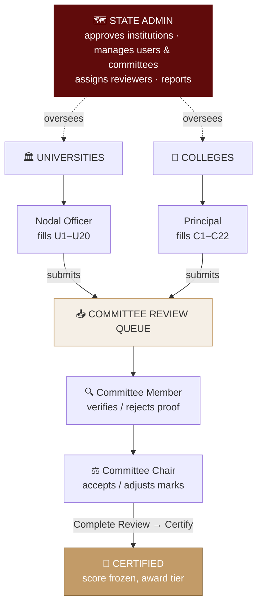
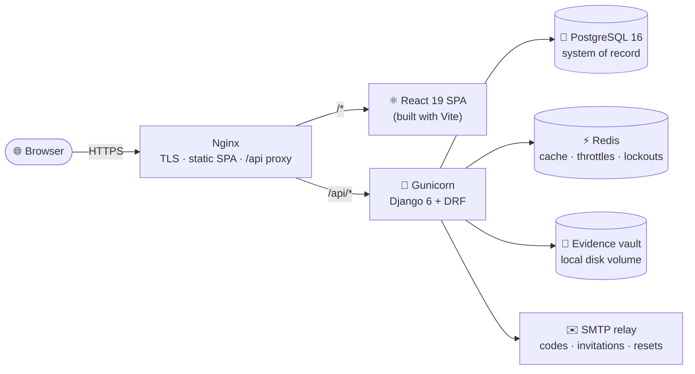
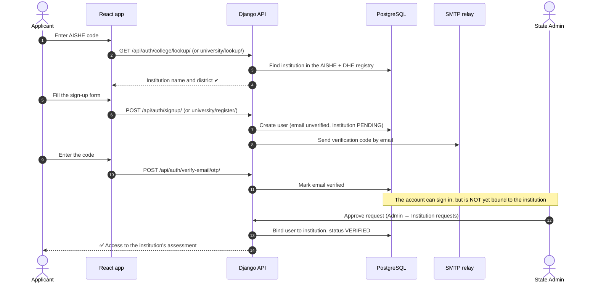
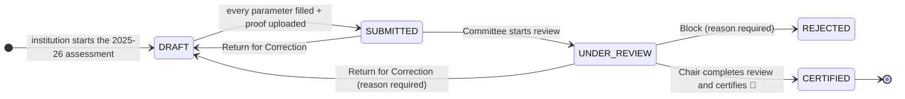
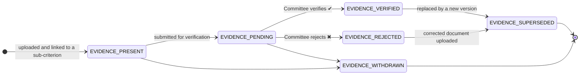
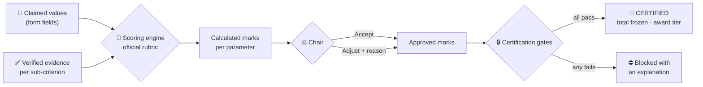
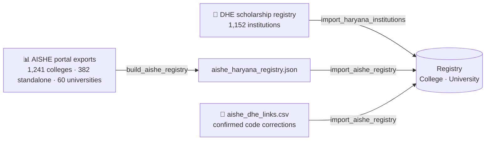
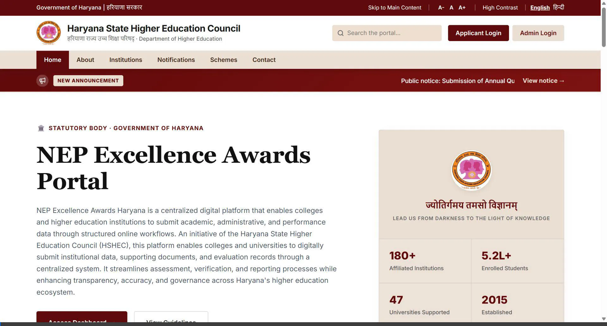

The ChatGPT Link with all the work - https://chatgpt.com/share/6ab7cd81-895c-83ee-9114-93d458a872bf

<div align="center">


<a href="https://git.io/typing-svg">
  
</a>

<p>
  
  
  
  
  
  
</p>
<p>
  
  
  
  
</p>

</div>

---

## 📑 Contents

- [What is this?](#-what-is-this)
- [Who does what](#-who-does-what)
- [System architecture](#%EF%B8%8F-system-architecture)
- [Workflow 1 · Sign-up and onboarding](#-workflow-1--sign-up-and-onboarding)
- [Workflow 2 · The assessment lifecycle](#-workflow-2--the-assessment-lifecycle)
- [Workflow 3 · Evidence (proof) lifecycle](#-workflow-3--evidence-proof-lifecycle)
- [Workflow 4 · Scoring, awards and certification](#-workflow-4--scoring-awards-and-certification)
- [The institution registry (AISHE + DHE)](#%EF%B8%8F-the-institution-registry-aishe--dhe)
- [Project structure](#-project-structure)
- [Run it locally](#-run-it-locally)
- [Demo data and logins](#-demo-data-and-logins)
- [Tests and quality gates](#-tests-and-quality-gates)
- [Configuration](#%EF%B8%8F-configuration)
- [Deployment](#-deployment)
- [API reference](#-api-reference)
- [Security highlights](#%EF%B8%8F-security-highlights)
- [Video tour](#-video-tour)

---

## 🤔 What is this?

The Government of Haryana gives **NEP Excellence Awards** to its universities and colleges for how well they implement the National Education Policy. This portal runs the whole process online, for the assessment year **1 July 2025 – 30 June 2026**:

| Step | Who | What happens |
|:---:|---|---|
| 1️⃣ | 🏫 Institution | Registers with its **AISHE code**, verifies its email, and is approved by the State Admin |
| 2️⃣ | 🏫 Institution | Fills in the NEP 2026 self-assessment: **C1–C22** for colleges, **U1–U20** for universities |
| 3️⃣ | 🏫 Institution | Uploads **proof documents** for every claim, then submits; the form locks |
| 4️⃣ | 🔍 Screening Committee | Checks every document and **verifies** or **rejects** it, with a reason |
| 5️⃣ | 🖥️ Server | Calculates the marks from the official rubric, using **verified proof only** |
| 6️⃣ | ⚖️ Committee Chair | Accepts or adjusts each parameter's marks (adjustments need a written reason), completes the review and **certifies** |
| 7️⃣ | 🗺️ State Admin | Watches every institution's stage, assigns reviewers, manages users and committees, and pulls reports |

> [!IMPORTANT]
> **Golden rule: `NO VERIFIED PROOF = NO MARKS`.** The browser never calculates marks. People can only *verify*, *accept*, or *adjust with a written reason*, and every action is recorded in an append-only audit log.

---

## 🧭 Who does what



| Role (`User.role`) | Who | Works in |
|---|---|---|
| `principal` | 🏫 College Principal: fills the college assessment (C1–C22) | `/institution/<name>/<aishe>/dashboard` |
| `nodal_officer`, `university_admin` | 🏛️ University Nodal Officer / Administrator: fills the university assessment (U1–U20) | `/university` |
| `committee` | 🔍 Screening Committee Member: verifies proof, reviews assessments | `/checker/queue` |
| `committee_chair` | ⚖️ Screening Committee Chair: approves marks, **the only role that can certify** | `/checker/queue` |
| `head_admin`, `state_admin`, `admin` | 🗺️ State / DHE administration: oversight, users, committees, reviewer assignment, reports | `/admin` |
| `empowered_committee`, `empowered_committee_chair` | 🏛️ Empowered Committee | `/empowered` |

### 🗺️ What the State Admin can and cannot do

| ✅ Can | ❌ Cannot |
|---|---|
| See **every** institution and its stage, including those that have not started | Fill in an institution's form |
| Approve or reject institution access requests from new sign-ups | Verify or reject evidence (the Committee's job) |
| Create users, invite them, reset passwords, and set up committees and chairs | Accept or change marks outside the workflow |
| Assign or reassign a reviewer (a reason is required for reassignment) | **Certify**; only the Committee Chair can, and the server enforces it |
| Open any assessment read-only; export CSV; read the audit trail | |

**Admin console pages:** Overview (`/admin`) · Institutions (`/admin/institutions`) · Institution requests (`/admin/institution-requests`) · Users (`/admin/users`) · Committees (`/admin/committees`) · Reports (`/admin/reports`).

---

## 🏗️ System architecture



**Django apps:** `authentication` · `college` · `university` · `evidence` · `scoring` · `admin_panel` · `reports` (plus the legacy `nominations` / `forms`).

| Layer | Technology |
|---|---|
| **Frontend** | React 19, React Router 7, Vite 8, Tailwind CSS 3, Framer Motion, Recharts, Lucide icons |
| **Backend** | Django 6.0, Django REST Framework 3.17, custom JWT auth (PyJWT), WhiteNoise, Gunicorn |
| **Database** | PostgreSQL (required in production); SQLite for local development |
| **Cache** | Redis (required in production); in-memory locally |
| **Files** | Evidence vault on the server's disk, with atomic writes, magic-byte type checks and PDF structure checks (pypdf) |
| **Email** | SMTP: sign-up verification codes, invitations, password resets |

---

## 🔐 Workflow 1 · Sign-up and onboarding

New applicants (College Principals and University Nodal Officers) pass **three gates** before they can touch an assessment: the AISHE code check, email verification, and admin approval.



- **Verification codes** expire after **10 minutes**, allow **5 attempts**, have a **60-second resend cooldown** and a limit of **5 sends per hour**. All of these can be configured.
- If the email cannot be sent, sign-up returns HTTP 503 and is **rolled back**. The portal never claims it sent an email it did not send.
- Staff accounts (committee members, admins) are created by an administrator and activated through an **invitation link**.
- Logins are protected by a **lockout after repeated failures** and by API throttling (anonymous 120/min, signed-in 240/min).

---

## 🔄 Workflow 2 · The assessment lifecycle



| # | Step | Who | Details |
|:---:|---|---|---|
| 1 | **Fill in** | Principal / Nodal Officer | The form checks the numbers before accepting a submission, e.g. *students placed* cannot exceed *students who took part* |
| 2 | **Upload proof** | Principal / Nodal Officer | Each sub-criterion asks for a specific kind of document. PDF, PNG, JPG, WEBP, DOCX and XLSX are accepted, up to 5 MB each. Uploading alone gives **no** marks |
| 3 | **Submit** | Principal / Nodal Officer | The server checks readiness, then the form locks |
| 4 | **Start Review** | Committee | The assessment moves to `UNDER_REVIEW` |
| 5 | **Verify proof** | Committee | Each document is viewed beside its claim → **Verify** or **Reject** with a structured reason (illegible, incomplete, out of period, mismatched, unsigned…) |
| 6 | **Approve marks** | Chair | For each parameter: **Accept** the calculated score, or **Adjust** it with a written reason |
| 7 | **Return or block** | Committee | **Return for Correction** sends it back to `DRAFT` to fix; **Block** stops it (`REJECTED`) |
| 8 | **Complete Review → Certify** | Chair only | All certification gates must pass; the score and parameter data are then **frozen** |
| 9 | **Watch** | State Admin | Stages shown: *Not started → Filling in → Submitted → Under review → Awaiting certification → Certified* (or *Returned*) |

---

## 📎 Workflow 3 · Evidence (proof) lifecycle



- Only **`EVIDENCE_VERIFIED`** proof unlocks marks in the scoring engine.
- Files are checked by **magic bytes**, not file names; PDFs are **structurally parsed**; and a content hash is stored to detect tampering.
- Evidence is served **only through authenticated API views**, checked against the user's institution or review assignment. The storage folder is never exposed directly.
- Every action (upload, submit, verify, reject, assign, supersede, withdraw) is written to an **append-only audit log**.

---

## 🧮 Workflow 4 · Scoring, awards and certification



| | 🏛️ University | 🏫 College |
|---|---|---|
| Framework | `UNIVERSITY_2026` | `COLLEGE_2026` |
| Parameters | **U1 – U20** | **C1 – C22** |
| Maximum | 100 marks | 100 marks |
| Filled by | Nodal Officer | Principal |

- A university is never marked with the college rubric, and a college is never marked with the university rubric. The server rejects any framework mismatch.
- **Certification gates** include:
  - the assessment is not already certified or blocked, and its framework matches;
  - the person certifying is the **Committee Chair**;
  - every parameter is approved, and the scoring engine produces a certified total;
  - the Committee has recorded **Complete Review** for the current submission;
  - no council policy decision is pending.
- **Award tiers** are **Platinum / Gold / Bronze**. The cut-off scores come from the State Council (`NEP_2026_AWARD_THRESHOLDS`). Until they are configured, the portal shows the score and says the thresholds are missing; it does not guess a tier.

---

## 🗂️ The institution registry (AISHE + DHE)

Sign-up only works for institutions that exist in the official registry. Two sources are loaded, **in this order**:



```bash
cd Backend
python manage.py import_haryana_institutions   # 1. DHE registry
python manage.py import_aishe_registry         # 2. AISHE list (re-run after any DHE re-import)
```

- **`C-` and `S-`** codes register as colleges; **`U-`** codes register as universities.
- To refresh the AISHE list from new portal exports, see [`Backend/data/aishe_import/README.md`](Backend/data/aishe_import/README.md).

---

## 📁 Project structure

```text
NEP_HARYANA/
├── Backend/                      # Django 6 + DRF API
│   ├── config/settings/          # base · development · production · ci
│   ├── apps/
│   │   ├── authentication/       # users, roles, JWT, email codes, invitations, AISHE lookup, registry imports
│   │   ├── college/              # college assessments (C1–C22) and the review workflow
│   │   ├── university/           # university assessments (U1–U20) and the review workflow
│   │   ├── evidence/             # evidence vault, validation, verification, assignments, audit log
│   │   ├── scoring/              # rubric engine, field schemas, policy gates, award tiers
│   │   ├── admin_panel/          # State Admin APIs: users, committees, queue, institutions
│   │   ├── reports/              # state and assessment reports, CSV export
│   │   └── nominations/, forms/  # legacy nomination flow
│   └── data/aishe_import/        # DHE + AISHE registry data
├── Frontend/NEP_HARYANA_INT/     # React 19 + Vite single-page app
│   └── src/                      # pages · components · api · context · hooks · utils
├── demo_tools/                   # demo seeding and reset scripts (development only)
├── docs/
│   ├── deployment/               # server / VM requirements (PDF + Markdown)
│   ├── audits/                   # audit and readiness reports
│   └── *.xlsx                    # AISHE source exports
└── package.json                  # `npm run dev` starts the backend and frontend together
```

---

## ⚡ Run it locally

**Prerequisites:** Python 3.12+, Node.js 20+ (CI uses Node 24), Git.

**1 · Backend (Django on port 8000)**

```bash
python -m venv venv
venv\Scripts\activate                     # Windows  (Linux/macOS: source venv/bin/activate)
pip install -r Backend/requirements.txt
cd Backend
python manage.py migrate
python manage.py import_haryana_institutions
python manage.py import_aishe_registry
python manage.py create_dev_users         # development logins only
python manage.py runserver 8000
```

**2 · Frontend (Vite on port 5173)**

```bash
cd Frontend/NEP_HARYANA_INT
npm install
npm run dev
```

Or start both at once from the repository root with **`npm run dev`** (after running `npm install` there). Then open **http://localhost:5173**.

---

## 🧪 Demo data and logins

<details>
<summary><b>▶ Seed a full demo: 5 colleges + 3 universities at different stages</b></summary>

<br/>

`demo_tools/seed_demo.py` drives real assessments through the live API, so **the backend must be running**.

```bash
# from the repo root, with the backend running on :8000
venv\Scripts\python.exe demo_tools\wipe_institutions.py      # ⚠️ deletes ALL institutions and submissions (dev only)
set PYTHONPATH=demo_tools && venv\Scripts\python.exe demo_tools\seed_demo.py
```

| Institution | Login (password `Demo@1234`) | Seeded at | Try |
|---|---|---|---|
| Govt. College, Sector 9, Gurugram | `principal.gurugram@demo.local` | Not started | Fill the form from scratch |
| Dayanand College, Hisar | `principal.hisar@demo.local` | Filled + proof uploaded | **Submit** |
| Govt. College for Women, Rohtak | `principal.rohtak@demo.local` | Submitted | Committee: start review, verify proof |
| Hindu College, Sonepat | `principal.sonepat@demo.local` | Under review, proof verified | Chair: accept / adjust marks |
| Dyal Singh College, Karnal | `principal.karnal@demo.local` | All marks approved | Chair: **Complete Review → Certify** |
| Kurukshetra University | `nodal.kuk@demo.local` | Not started | Fill U1–U20 |
| Maharshi Dayanand University, Rohtak | `nodal.mdu@demo.local` | Submitted | Committee review |
| Guru Jambheshwar University, Hisar | `nodal.gju@demo.local` | All marks approved | Chair: certify |

To make the **Dev College / Dev University** blank again without touching the demo institutions:

```bash
venv\Scripts\python.exe demo_tools\reset_dev_institutions.py
```

</details>

<details>
<summary><b>▶ Development logins (created by <code>create_dev_users</code>)</b></summary>

<br/>

| Role | Email | Password |
|---|---|---|
| 🗺️ Admin | `admin@dev.local` | `DevAdmin@123` |
| 🔍 Committee Member | `committee@dev.local` | `DevCommittee@123` |
| ⚖️ Committee Chair | `chair@dev.local` | `DevChair@123` |
| 🏫 Principal (Dev College) | `principal@dev.local` | `DevPrincipal@123` |
| 🏛️ Nodal Officer (Dev University) | `nodal@dev.local` | `DevNodal@123` |
| 🏛️ University Admin (Dev University) | `univadmin@dev.local` | `DevUnivAdmin@123` |

</details>

> [!WARNING]
> These accounts and scripts are for **local development only**. Never run `create_dev_users`, `seed_demo.py` or the reset scripts against production.

---

## ✅ Tests and quality gates

```bash
# Backend: unit and integration tests
cd Backend
python manage.py test apps

# Frontend: tests, lint gate, build and bundle credential scan
cd Frontend/NEP_HARYANA_INT
npm test
npm run lint:gate
npm run build && npm run check:bundle
```

The CI workflow (`.github/workflows/master_nep-excellence.yml`) runs the same checks as a release gate: migration completeness, `check --deploy` under production settings, backend tests, frontend tests, the lint gate, the build and the bundle scan.

---

## ⚙️ Configuration

Local settings are read from `Backend/.env` (start from `Backend/.env.example`). Production reads them from the service environment and **refuses to start** without the required ones.

| Variable | Purpose | Required in production |
|---|---|:---:|
| `DJANGO_SETTINGS_MODULE` | `config.settings.production` on servers (`manage.py` defaults to development) | ✅ |
| `DJANGO_SECRET_KEY`, `JWT_SIGNING_KEY` | Signing keys (at least 50 random characters) | ✅ |
| `DATABASE_URL` | PostgreSQL connection string; SQLite is refused | ✅ |
| `REDIS_URL` | Shared cache for lockouts, throttles and sessions | ✅ |
| `ALLOWED_HOSTS`, `FRONTEND_URL` | Public domain; base URL used in email links | ✅ |
| `MEDIA_ROOT` / `EVIDENCE_STORAGE_VAULT` | Evidence folder on a persistent volume | ✅ |
| `EMAIL_HOST`, `EMAIL_PORT`, `EMAIL_USE_TLS`, `EMAIL_HOST_USER`, `EMAIL_HOST_PASSWORD`, `DEFAULT_FROM_EMAIL` | SMTP relay | ✅ |
| `SECURE_PROXY_SSL_HEADER` | `true` behind Nginx | ✅ |
| `MAX_EVIDENCE_FILE_SIZE` | Upload limit, default 5 MB | optional |
| `EMAIL_OTP_TTL_MINUTES`, `EMAIL_OTP_MAX_ATTEMPTS`, … | Verification code policy | optional |
| `VITE_API_BASE_URL` | Frontend build only, if the API is on another domain | optional |

> [!CAUTION]
> Never commit `.env` files, passwords or keys.

---

## 🚀 Deployment

The portal has **not been deployed yet**. The planned hosting is a set of Ubuntu 24.04 VMs: an application server (Nginx + Gunicorn + Redis), a PostgreSQL server, a staging server, and separate backup storage.

| Document | What it covers |
|---|---|
| [`SERVER_REQUIREMENTS_SUMMARY.pdf`](docs/deployment/SERVER_REQUIREMENTS_SUMMARY.pdf) | 2-page server and VM requirements, for the infrastructure team |
| [`VM_SERVER_REQUIREMENTS.md`](docs/deployment/VM_SERVER_REQUIREMENTS.md) | Full technical assessment: architecture, ports, environment variables, backups, open gaps |
| [`VM_SERVER_REQUIREMENTS_EMAIL.md`](docs/deployment/VM_SERVER_REQUIREMENTS_EMAIL.md) | Covering email for the server request |

---

## 📡 API reference

<details>
<summary><b>▶ Authentication and onboarding</b> · <code>/api/auth/</code></summary>

<br/>

| Method | Endpoint | Purpose |
|---|---|---|
| GET | `college/lookup/?aishe_code=` · `university/lookup/?aishe_code=` | Check an AISHE code against the registry |
| POST | `signup/` · `university/register/` | Register a principal / nodal officer |
| POST | `verify-email/otp/` · `verify-email/otp/resend/` | Verify the emailed code / send a new one |
| POST | `login/` · `refresh/` · `logout/` | JWT sign-in, refresh, sign-out |
| GET | `me/` | Current user and institution binding |
| POST | `forgot-password/` · `reset-password/` | Password reset |
| POST | `activate/verify/` · `activate/confirm/` | Staff invitation activation |

</details>

<details>
<summary><b>▶ College assessments</b> · <code>/api/v1/college/</code></summary>

<br/>

| Method | Endpoint | Purpose |
|---|---|---|
| GET / POST | `colleges/<pk>/assessments/` | List / start a college's assessments |
| GET / PATCH | `college/assessments/<id>/parameters/<code>/` | Read / save a parameter |
| GET | `college/assessments/<id>/readiness/` · `coverage/` | Submission readiness, evidence coverage |
| POST | `college/assessments/<id>/submit/` | Submit (locks the form) |
| GET | `college/review/queue/` | Committee review queue |
| POST | `college/assessments/<id>/review/start/` · `complete/` · `return/` · `block/` | Review workflow |
| POST | `college/assessments/<id>/parameters/<code>/accept-score/` · `adjust-score/` | Chair approves / adjusts marks |
| POST | `college/assessments/<id>/certify/` | Chair certifies |

</details>

<details>
<summary><b>▶ University assessments</b> · <code>/api/v1/university/</code></summary>

<br/>

| Method | Endpoint | Purpose |
|---|---|---|
| GET / POST | `universities/<pk>/assessments/` | List / start a university's assessments |
| GET / PATCH | `university-assessments/<id>/parameters/<code>/` | Read / save a parameter |
| POST | `university-assessments/<id>/submit/` | Submit |
| GET | `university-assessments/review-queue/` | Committee review queue |
| POST | `university-assessments/<id>/start-review/` · `complete-review/` · `return-for-correction/` · `block-review/` | Review workflow |
| POST | `university-assessments/<id>/parameters/<code>/accept-score/` · `adjust-score/` | Chair approves / adjusts marks |
| POST | `university-assessments/<id>/certify/` | Chair certifies |

</details>

<details>
<summary><b>▶ Evidence</b> · <code>/api/evidence/</code></summary>

<br/>

| Method | Endpoint | Purpose |
|---|---|---|
| GET / POST | `/api/evidence/` | List / upload evidence |
| GET | `<id>/document/` · `<id>/download/` | View / download (authorised users only) |
| POST | `<id>/associate/` · `<id>/submit/` · `<id>/withdraw/` | Link to a sub-criterion, submit, withdraw |
| POST | `<id>/verify/` · `<id>/reject/` | Committee decision on a document |
| POST | `associations/<id>/verify/` · `associations/<id>/reject/` | Committee decision per sub-criterion |
| POST | `<id>/assign/` · `<id>/unassign/` | Reviewer assignment |
| GET | `review-queue/` · `coverage/` · `readiness/` · `<id>/history/` | Queue, coverage, audit history |

</details>

<details>
<summary><b>▶ State admin and reports</b> · <code>/api/v1/</code></summary>

<br/>

| Method | Endpoint | Purpose |
|---|---|---|
| GET | `admin/control-centre/summary/` | State overview and "needs attention" lists |
| GET | `admin/institutions/` | Every institution and its stage |
| GET / POST | `admin/users/` · `admin/users/<id>/…` | Users, invitations, password resets, audit, institution access |
| GET / POST | `admin/committees/` · `…/chair/` · `…/members/` | Committees |
| GET | `admin/review-queue/` | State-wide review queue |
| POST | `admin/assessments/<id>/assign/` | Assign / reassign a reviewer |
| GET | `reports/admin/summary/` · `reports/assessments/<id>/…` · `…/export/` | Reports and CSV export |

</details>

---

## 🛡️ Security highlights

- 🔑 **JWT sessions with version stamps.** A password reset, deactivation or role change ends every open session.
- 🚦 **Login lockout and throttling**, backed by Redis in production so all workers share the counters.
- 🧾 **Append-only audit logs** for evidence, reviews, scores and admin actions.
- 🧱 **Permissions enforced by the server.** The UI hides buttons, but the API is what enforces permissions; for example, only the Chair can certify.
- 📁 **Evidence validation and isolation:** magic-byte type checks, PDF parsing, hashing, an atomic-write vault, and access only through authorised views.
- 🏭 **Production refuses unsafe settings:** the development secret key, SQLite, a missing Redis, or console email.

---

## 🎬 Video tour

<div align="center">
  <a href="./website_full_tour.mp4">
    
  </a>
  <p><em>Landing page, institution dashboard, evidence upload, committee review and the State Admin console. Click for the full video.</em></p>
</div>

---

<div align="center">


<sub>Department of Higher Education (DHE), Government of Haryana • Haryana State Higher Education Council (HSHEC)</sub>

</div>
